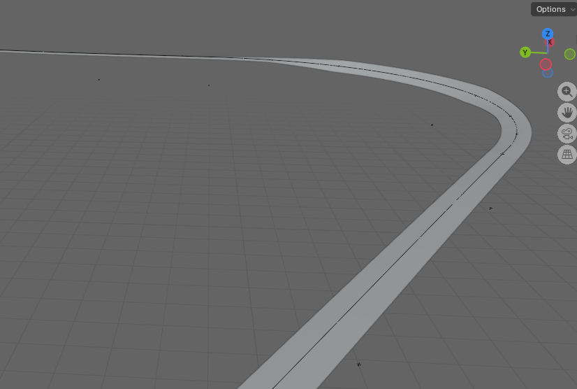
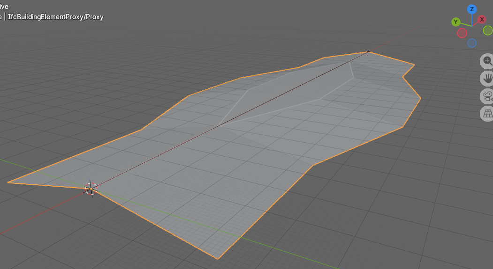
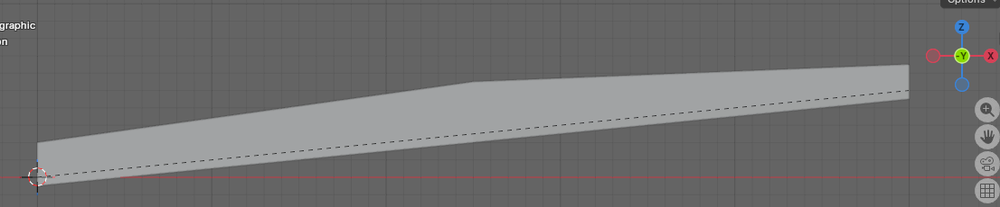
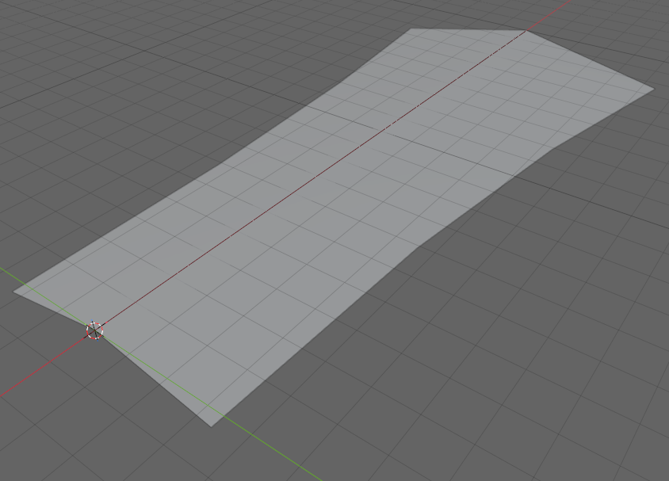
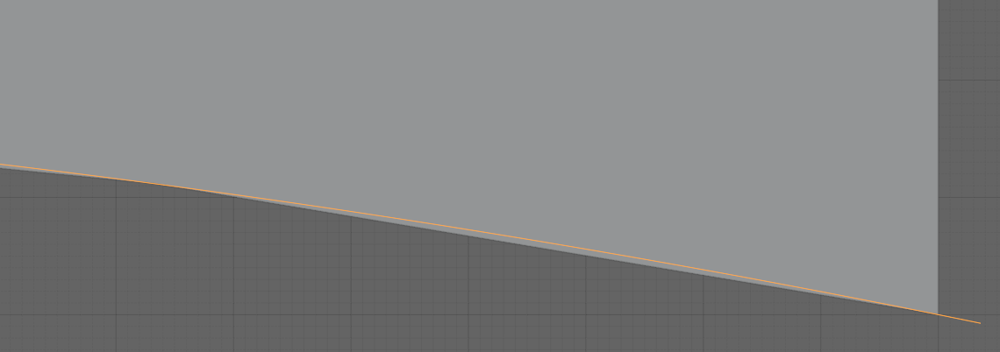

# Chapter 10 — Sectioned Surfaces and Solids

## 10.0 Introduction

A common approach in roadway design software is template-based modeling: define a cross-section template, apply it at regular intervals along the alignment, and interpolate the geometry between positions. For simple, uniform roadways — constant width, constant cross-slope — this works well. But most roadways are not uniform. They taper in and out; include medians that appear and disappear; require superelevation transitions; and feature traffic islands, widenings, and complex intersection geometry. For these cases, interpolating between evenly-spaced template stamps produces piecewise-linear geometry that can only approximate the intended design.

Road design software has long addressed this limitation through the concept of *strings* — continuous three-dimensional threads tracing significant features along the route: the edge of pavement, the shoulder break, the top of curb, the back of curb. Rather than deriving edges from template interpolation, strings define the edges explicitly. The cross-sections through the design are understood as sections through the string model, not the primary definition.

IFC4x3 introduces two geometry entities specifically for infrastructure: `IfcSectionedSurface` and `IfcSectionedSolidHorizontal`. Both define geometry by sweeping cross-sections along a `Directrix` — typically an alignment curve. `IfcSectionedSurface` uses open cross-sections to produce a surface; `IfcSectionedSolidHorizontal` uses closed cross-sections to produce a volumetric solid. Both support two complementary approaches to defining the geometry: template-based (cross-sections at defined distances along the directrix, linearly interpolated between) and string-line-based (guide curves that control where tagged cross-section points travel between sections). The IFC specification leaves several aspects of these entities underspecified — particularly around guide curve behavior, tag scoping, and the interaction between authored sections and guide curves. These gaps are significant enough that consistent implementations cannot be guaranteed without additional guidance; they are identified and discussed in §10.5.

## 10.1 Template-Based Approach

In the template-based approach, cross-sections are defined at discrete distances along the `Directrix`. The geometry engine interpolates linearly between consecutive cross-section positions to generate the surface or solid. The cross-sections need not be identical — width, slope, and shape can all vary from one distance to the next — but the transition between any two consecutive sections is linear.

For simple geometry this is entirely adequate. A road with a constant typical section can be fully described by two cross-sections with linear interpolation between them. A superelevation transition with a uniform rotation rate can be captured with sections at each end of the transition. The template approach becomes strained when the geometry between defined sections is not linear — a curved edge taper through a widening, for example — requiring progressively denser section spacing to reduce the approximation error.

Inevitably, all roadways encounter other roadways, requiring complex intersection designs that must move smoothly through 3D space. This is where template-based design becomes difficult.

## 10.2 String Lines

A string line is a continuous three-dimensional curve tracing the path of a specific feature along the full extent of the design, such as edge of pavement, shoulder break, or top of curb. Where the template approach interpolates linearly between section endpoints, a string line defines the exact trajectory of a tagged cross-section point, independent of section density.

In IFC, string lines are represented as `IfcOffsetCurveByDistances` instances. The `Tag` attribute on `IfcOffsetCurveByDistances` connects a guide curve to the cross-section points that carry the matching tag value. A tagged point in a cross-section profile is constrained to follow the guide curve carrying the same tag.

> **Note:** The IFC specification's terminology is inconsistent. `IfcSectionedSolidHorizontal` uses "string line" and "guide curve," while `IfcSectionedSurface` uses "transitions curves" [sic]. In the context of this chapter, the terms *string line* and *guide curve* are used; however, all three terms mean the same thing.

> **Note:** [`IfcElement.Tag`](https://ifc43-docs.standards.buildingsmart.org/IFC/RELEASE/IFC4x3/HTML/lexical/IfcElement.htm) is an entirely different attribute and is not used by the string line mechanism described in this chapter. `IfcElement.Tag` is an optional identifier string for a physical element instance (e.g. a manufacturer's tag or asset number) and has no relationship to the `Tag` attributes discussed here, which appear on `IfcOffsetCurveByDistances`, `IfcOpenCrossProfileDef`, and `IfcCartesianPointList2D`. The name is coincidental.

The tag mechanism differs between the two entities:

- For `IfcSectionedSurface`, tags are carried by `IfcOpenCrossProfileDef.Tags` — a list of $N+1$ labels, one per vertex of the open profile. Each vertex can be independently associated with a guide curve.
- For `IfcSectionedSolidHorizontal`, tags are carried by `IfcCartesianPointList2D.TagList` — one label per coordinate in the point list. Closed profiles are typically `IfcArbitraryClosedProfileDef` whose `OuterCurve` is an `IfcIndexedPolyCurve` referencing an `IfcCartesianPointList2D`; the `TagList` on that point list provides a label for each profile vertex.

In both cases, the intended behavior is that the geometry at a tagged cross-section point follows the corresponding guide curve — allowing, for example, a widening with a curved edge taper to be defined by sections only at the start and end of the transition, with the guide curve carrying the taper geometry between them.

The string line approach is not an alternative to the template approach but an augmentation of it. Cross-sections are always required; guide curves control interpolation between them.

## 10.3 IfcSectionedSurface

`IfcSectionedSurface` defines a surface by sweeping open cross-sections along a directrix curve.

| Attribute | Type | Description |
|-------------------------|------------------------------|---------------------------------------------|
| `Directrix` | `IfcCurve` | The curve along which sections are swept |
| `CrossSectionPositions` | `LIST [2:?] OF IfcAxis2PlacementLinear` | Positions along the directrix at which sections are placed |
| `CrossSections` | `LIST [2:?] OF IfcProfileDef` | Open cross-section profiles, one per position |

*Table 10.3-1 — IfcSectionedSurface attributes*

The surface is generated by sweeping the cross-sections between the defined `CrossSectionPositions`. It does not extend to the head or tail of the `Directrix` — the surface is bounded by its first and last cross-section positions. The `CrossSectionPositions` and `CrossSections` lists must be equal in length. Figure 10.3-1 illustrates a sectioned surface through a superelevation transition, showing how the open cross-section profile varies along the directrix.

*Figure 10.3-1 — Sectioned surface illustrating a superelevation transition*

### 10.3.1 Breaklines

In the context of `IfcSectionedSurface`, a breakline is a line along the surface where the cross-slope changes abruptly — an edge of pavement, a shoulder break, the face of a curb. This usage is distinct from DTM breaklines, which force TIN triangulation to honor a feature edge. Here the term describes a topological feature of the swept surface itself: a ridge or valley line where adjacent surface facets meet at a non-tangent angle.

Breaklines arise from the tag mechanism when consecutive cross-sections have different numbers of segments. A widening lane introduces a new vertex at the distance along the directrix where the widening begins. Tags identify which vertices in one section correspond to vertices in the next, even when the two sections have different segment counts. A vertex present in one section but absent in the adjacent section causes the surface to initiate or terminate at that longitudinal position, which is the geometric definition of a breakline in this context. `IfcOpenCrossProfileDef` is the only profile that supports breaklines. Figure 10.3.1-1 illustrates a sectioned surface with breaklines resulting from cross-section topology changes along the route. `IfcSectionedSolidHorizontal` does not support the concept of breaklines.

*Figure 10.3.1-1 — Sectioned surface with breaklines at cross-section topology changes. (source bSI)*

Figure 10.3.1-2 shows a sectioned surface inspired by Figure 10.3.1-1 with both a widening and narrowing of the surface.

*Figure 10.3.1-2 — Sectioned surface with breaklines at cross-section topology changes. This figure shows the surface widening and returning to its original width.*

Although the IFC specification does not state this explicitly, the `Slope` and `Width` of an `IfcOpenCrossProfileDef` segment must be zero at the distance along the directrix where a breakline initiates or terminates. When a new feature vertex first appears — the start of a widening lane, for example — the cross-section at that distance must include the new tagged vertex with a zero-width segment. In Figure 10.3.1-1, this is why points B and D coincide in the second cross-section: the zero-width segment collapses those tagged vertices to the same position, establishing the breakline origin without introducing lateral extent. Without a zero-width segment at the breakpoint position, the surface has no defined starting position for the new feature and the geometry is ambiguous. The branching example in §10.6.1.3 illustrates this pattern for a surface where breaklines branch from the main cross-section.

The tag mechanism serves both breaklines and string lines simultaneously. A tag on a profile vertex identifies that vertex's correspondence across sections with different topology and, when a matching `IfcOffsetCurveByDistances` guide curve exists, controls the vertex's trajectory between sections. The two functions — topological correspondence and geometric guidance — share the same tag infrastructure.

### 10.3.2 String Lines

Within `IfcSectionedSurface`, string lines are implemented through the `Tags` attribute of `IfcOpenCrossProfileDef`. This attribute holds a list of $N+1$ labels — one per vertex of the open profile, where $N$ is the number of segments. An `IfcOffsetCurveByDistances` guide curve whose `Tag` matches one of these vertex labels takes control of that vertex's trajectory along the surface.

The `OffsetPoint` attribute of `IfcOpenCrossProfileDef` positions the first tagged vertex in the directrix's local coordinate system. Subsequent vertices are derived from there by accumulating the segment `Widths` and `Slopes`. It is unclear whether all tagged vertices participate in the matching process independently, allowing a surface to have some vertices guided by offset curves and others governed by linear interpolation between authored sections (see §10.5.2).

### 10.3.3 Cross-Section Coordinate System

The profiles of `IfcSectionedSurface` and `IfcSectionedSolidHorizontal` are defined in a local coordinate system established at each cross-section position by the corresponding `IfcAxis2PlacementLinear`. The axes of this local frame are:

- **X** — the lateral axis, pointing to the **left** of a traveler moving in the direction of increasing chainage.
- **Y** — the vertical axis, aligned with the `Axis` direction of `IfcAxis2PlacementLinear` (typically global vertical, $(0, 0, 1)$).
- **Z** — the extrusion direction, tangent to the directrix in the direction of increasing chainage.

The left-pointing X direction follows from the right-hand rule. Denoting the unit tangent as $\hat{t}$ and the `Axis` direction as $\hat{u}$:

$$\hat{x} = \hat{u} \times \hat{t}$$

With $\hat{u}$ pointing up and $\hat{t}$ in the direction of travel, $\hat{x}$ points to the left, and the frame satisfies $\hat{x} \times \hat{y} = \hat{z}$. Assigning X to the right would reverse this cross product, producing a left-handed system — incompatible with the extrusion direction occupying the +Z axis.

**Contrast with drafting convention.** When engineers draw a cross-section on paper, the conventional choice is X to the right and Y upward. The IFC cross-section coordinate system is the mirror image of this: X points to the left and Y remains upward. The visual appearance of the cross-section drawing is unchanged — features left of the alignment still appear on the left side of the drawing — but the X axis arrow points in the opposite direction. The practical consequence is that **positive X profile coordinates are to the left of the alignment centerline, and negative X coordinates are to the right**. Engineers accustomed to computing profile widths with positive values to the right must reverse the sign when authoring IFC profile geometry. The `OffsetPoint` of `IfcOpenCrossProfileDef` and the vertex coordinates in `IfcCartesianPointList2D` (for `IfcSectionedSolidHorizontal`) are both expressed in this left-X frame.

## 10.4 IfcSectionedSolidHorizontal

`IfcSectionedSolidHorizontal` defines a solid by sweeping closed cross-sections along a directrix curve. It follows the same fundamental structure as `IfcSectionedSurface` but produces a volumetric solid bounded by the swept faces and the cross-section planes at each end.

| Attribute | Type | Description |
|-------------------------|------------------------------|---------------------------------------------|
| `Directrix` | `IfcCurve` | The curve along which sections are swept |
| `CrossSectionPositions` | `LIST [2:?] OF IfcAxis2PlacementLinear` | Positions along the directrix at which sections are placed |
| `CrossSections` | `LIST [2:?] OF IfcProfileDef` | Closed cross-section profiles, one per position |

*Table 10.4-1 — IfcSectionedSolidHorizontal attributes*

As with `IfcSectionedSurface`, the solid is generated by sweeping only between the defined `CrossSectionPositions`. It does not extend to the head or tail of the `Directrix` (see §10.5.5). The `CrossSectionPositions` and `CrossSections` lists must be equal in length, and the position expressions must not use longitudinal offsets.

Cross-sections are typically `IfcArbitraryClosedProfileDef` profiles. The profile outline is defined as an `IfcIndexedPolyCurve` referencing an `IfcCartesianPointList2D`. Profile points are listed in counter-clockwise order when viewed from the direction the profile normal points. The `IfcCartesianPointList2D.TagList` attribute assigns a label to each point in the coordinate list, enabling the string line mechanism of §10.2. Guide curve hosting and tag scoping follow the same sibling-representation construction described for `IfcSectionedSurface` in §10.5.2, demonstrated through `IfcSectionedSolidHorizontal` examples in §10.6.2.5 and §10.6.2.6.

For a note on a documentation error in the profile orientation specification for this entity, see §10.5.6.

### 10.4.1 Rotations

Cross-section rotation accommodates superelevation — the banking of a road or rail cross-section along a curve. `IfcSectionedSolidHorizontal` supports two approaches.

**Single superelevation** applies a uniform rotation to the entire cross-section at each defined position along the directrix. `IfcDerivedProfileDef` expresses this rotation, with its `ParentProfile` referencing the base (unrotated) profile. Each entry in `CrossSections` can reference its own `IfcDerivedProfileDef` instance with a different rotation angle, allowing the rotation to vary along the directrix while the underlying profile shape remains constant.

**Multiple independent superelevations** apply when different parts of the cross-section rotate independently — for example, a divided highway where left and right carriageways have different cross-slopes, or a cross-section with a varying median shape. In this case each `CrossSection` is a distinct profile instance. The tagged points in `IfcCartesianPointList2D.TagList` and their corresponding `IfcOffsetCurveByDistances` guide curves control where each point travels independently along the route. The guide curves effectively encode the superelevation variation for each tagged feature point without requiring explicit rotation parameters.

## 10.5 Specification Gaps and Implementation Notes

### 10.5.1 Design History: The Guided Sweep Proposal

This section documents the origin of the tag-based guide curve mechanism used throughout this chapter. §10.5.2 and §10.5.3 rely on it as evidence of the specification writers' intended construction — not as historical background to a still-open question, but as the basis for stating that construction directly.

The tag-based guide curve mechanism described in this chapter originates from buildingSMART issue [bSI-InfraRoom/IFC-Specification #118](https://github.com/bSI-InfraRoom/IFC-Specification/issues/118), "[IFC Tunnel] Guided sweep representation" [9], opened to address a requirement for sectioned sweeps with varying profiles whose paths between profiles could be described in a non-linear manner. Two competing EXPRESS formalizations were drafted and posted to the issue ([guided_sweep_1.txt](https://github.com/bSI-InfraRoom/IFC-Specification/files/7276785/guided_sweep_1.txt), [guided_sweep_2.txt](https://github.com/bSI-InfraRoom/IFC-Specification/files/7276786/guided_sweep_2.txt)), alongside a discussion document ([2021-08-11_GuidedSweeps.pdf](https://github.com/bSI-InfraRoom/IFC-Specification/files/6968930/2021-08-11_GuidedSweeps.pdf)). An intermediate proposal described guiding curves independently as `IfcSegmentedReferenceCurve` instances positioned using `IfcPointByDistanceExpression`; the mechanism that ultimately shipped in the schema instead uses `IfcOffsetCurveByDistances`, though both approaches share the same underlying `IfcPointByDistanceExpression`-based referencing.

One considered formalization, `IfcLinearlyReferencedProfileDef`, was opposed during review specifically because it conflicted with the assumption, used throughout the schema, that `IfcProfileDef` is defined in a local x-y plane suitable for arbitrary extrusions and lofts — a reviewer objected that it was unclear how an `IfcExtrudedAreaSolid` would even be constructed from such a profile, and that the proposal "messes with too many well established concepts."

The mechanism that was adopted instead — tag matching between profile vertices and an independently-defined guide curve — was accepted with its principal weakness stated explicitly by its own proposer:

> The downside, however, is that the `IfcCartesianPoint` of the profile and the corresponding `IfcPointByDistanceExpression` of the GuidingCurve must be linked explicitly and might have slightly diverging locations. Consistency must be ensured/checked by the implementors, potentially by defining an upper threshold for the acceptable distance between them.

This confirms that the redundancy discussed in §10.5.3 is a known and accepted trade-off, not an oversight: the specification writers deliberately left consistency between a tagged vertex's authored coordinate and its guide curve's path as an implementer responsibility, with no schema-level enforcement proposed or adopted.

The resolution that ultimately closed the issue favored a simpler approach over a dedicated new profile-definition entity: a review comment pointed to the existing pattern of carrying an `Axis` (2D reference geometry) and a `Body` (swept solid geometry) as separate representations on the same product — as already used on `IfcWall` — as precedent for describing guiding curves and swept geometry as siblings rather than inventing new geometry types to carry them.

### 10.5.2 Guide Curve Hosting and Tag Resolution

Guide curves belong as `Items` in a second `IfcShapeRepresentation` — `RepresentationIdentifier = "Axis"`, `RepresentationType = "GeometricCurveSet"` — that is a sibling entry, alongside the representation holding the surface or solid, within the same `IfcProductDefinitionShape.Representations` list. This is the `Axis`/`Body` pattern already used elsewhere in IFC (for example, on `IfcWall`) and is the construction described in §10.5.1. Guide curves hosted this way are scoped to the `IfcProductDefinitionShape` they belong to, so tags need only be unique within that scope.

This does not close every case, however: if a model author places more than one `IfcSectionedSurface` or `IfcSectionedSolidHorizontal` across the representations of a single `IfcProductDefinitionShape` — schema-legal — representation scoping alone cannot determine which guide curves belong to which surface. Implementations should avoid this configuration.

Even under this construction, no IFC attribute, inverse relationship, or STEP entity identifier points from a tagged vertex to the guide curve that controls it — the only link is the shared string value of `Tag`. Because every guide curve for a surface or solid is collected into the same `IfcProductDefinitionShape`, resolving a guided vertex only requires comparing tags among that representation's `Items`, not searching the entire model. However, a model-wide search may be required (depending on the implementation) to find all the `IfcRepresentation`s that contain the surface or solid as an `IfcRepresentationItem`. From there the owning `IfcProductDefinitionShape` (either directly or by traversing `IfcRepresentationMap` -> `IfcMappedItem` -> `IfcShapeRepresentation`) can be interrogated for the sibling `"Axis"/"GeometricCurveSet"` representation.

### 10.5.3 Consistency Between Authored Coordinates and Guide Curves

A guided vertex's position is defined twice, through two independent mechanisms: once by the profile's authored coordinate, and once by the string line's own geometry. When a cross-section vertex is authored at a specific position and a guide curve with a matching tag passes through a different position for the same cross-section, the two descriptions disagree. The mechanism's own proposer (§10.5.1) stated plainly that the two "must be linked explicitly and might have slightly diverging locations," with consistency to be "ensured/checked by the implementors, potentially by defining an upper threshold for the acceptable distance between them." The intent was never that these two descriptions could legitimately diverge and be arbitrated by some precedence rule; it was that they are supposed to coincide, and keeping them so is an authoring responsibility, not a question a consuming application resolves case by case.

What remains a genuine, unresolved limitation is that this consistency has no schema-level enforcement: the specification provides no mechanism, tolerance value, or validation rule for detecting when an authored coordinate and its guide curve have drifted apart. A model can therefore still carry a defect — a divergence beyond whatever tolerance the authoring tool intended — that no consuming application can distinguish from a small, accepted numerical difference. Interoperability issues that follow from such a defect (visualization, surface area and volume estimates, clash detection) are a data-quality problem in the authored file, not a case of the specification failing to state which value is authoritative.

### 10.5.4 Partial Guide Curve Coverage

The IFC specification does not define what happens when a tagged cross-section vertex has no corresponding guide curve. The ambiguity is meaningful: if a tagged vertex with no matching guide curve falls back to linear interpolation between authored sections, then guide curves and linear interpolation can be freely mixed within the same surface or solid — some vertices precisely guided, others interpolated. If instead every tagged vertex is required to have a matching guide curve, models must supply redundant zero-offset guide curves for vertices whose trajectory is already linear (as in the centerline vertex of §10.6.1.4 and §10.6.2.5). The practical use case for mixing is clear: exterior edge vertices follow string line guide curves through a curved widening while interior breakline vertices use linear interpolation — combining the geometric precision of string lines with the simplicity of template-based sections. An implementation agreement is needed to confirm that a tagged vertex with no matching guide curve is treated as unguided and linearly interpolated, rather than as a modeling error.

### 10.5.5 Extent Along the Directrix

`IfcSectionedSurface` and `IfcSectionedSolidHorizontal` are bounded by their `CrossSectionPositions` — geometry is generated by sweeping only between the first and last defined position and does not extend to the head or tail of the `Directrix`. Figure 8.8.3.35.C in the IFC specification incorrectly depicts the solid extending to the head and tail of the `Directrix` when `CrossSectionPositions` are at interior distances, contradicting the specification text. The practical consequence of such extension would be severe: multiple `IfcSectionedSolidHorizontal` instances modeling sequential prisms along the same alignment — pavement layers, cut sections, fill sections — would each extend to the full alignment endpoints and overlap one another. Implementers should follow the specification text, not the figure.

Guide curve extent follows the opposite rule. The `IfcOffsetCurveByDistances` specification states that if the defined offset values do not span the full extent of the basis curve, the offsets implicitly continue with the same value toward the head and tail. For guide curves this means a constant offset string line — such as the edge of a uniform-width shoulder — can be expressed with a single `IfcPointByDistanceExpression` without requiring offset values at every cross-section position. The two behaviors are independent: guide curves extend implicitly because they control interpolation *within* the surface or solid's defined span, not because they extend that span.

### 10.5.6 Cross-Section Orientation: Default Axis Direction

Each `IfcAxis2PlacementLinear` entry in `CrossSectionPositions` defines the local coordinate system at which its corresponding cross-section is placed. The `Axis` attribute specifies the local "up" direction — the Z-axis of that coordinate system — which determines how the cross-section is oriented in 3D space. As discussed in §8.3.2, the default value of `Axis` when the attribute is omitted is not unambiguously defined in the IFC schema.

**Historical context.** During early development of `IfcSectionedSolidHorizontal` under IFC4x3, the `Axis` direction at each cross-section position was envisioned as always vertical — `(0, 0, 1)` in global coordinates. As the standard evolved through RC1–RC4 and ADD1, this assumption was replaced with an author-controlled `IfcAxis2PlacementLinear` allowing `Axis` to be specified explicitly per cross-section position. The resolved specification permits both interpretations, but the default when `Axis` is omitted remains undefined (see §8.3.2).

**Geometric consequence.** On a flat (zero-grade) alignment the two interpretations produce identical results. On a graded alignment they diverge:

- **Axis = (0, 0, 1).** The cross-section "up" direction is always global vertical. Cross-section faces are plumb — their planes are perpendicular to the horizontal projection of the directrix, not to the 3D curve tangent. For infrastructure design this is the natural interpretation: end views and cross-sections are in a vertical plane, heights are measured vertically, widths are measured horizontally.

- **Axis perpendicular to the 3D tangent.** The cross-section "up" direction tilts with the grade, remaining in the vertical plane containing the 3D tangent. Cross-section faces are truly perpendicular to the 3D curve. On a graded alignment the faces lean forward or backward relative to the direction of travel, producing a different solid with different volume and cross-sectional area at any given distance. This interpretation yields the same solid that `IfcExtrudedAreaSolid` would produce for the same profile swept along the same path.

On alignments with cant, the Axis = (0,0,1) interpretation would exclude the cross-section rotation from the sweep, requiring it to be explicitly constructed into the `IfcSectionedSurface` profile or the `IfcSectionedSolidHorizontal` section rotation mechanism. The other interpretation would allow for cant-defined rotation to occur by simply using the default axis direction, as discussed in §10.6.1.1 and §10.6.2.1.

Figures 10.5.6-1 and 10.5.6-2 show the retaining wall example of §10.6.2.4 swept along a 10% graded directrix. In Figure 10.5.6-1, `Axis` is supplied explicitly as `(0, 0, 1)` at each cross-section position and the end face is plumb. Figure 10.5.6-2 shows the same scenario with `Axis` omitted, rendered by two different IFC viewers that have adopted opposite defaults: the upper half uses the perpendicular-to-3D-tangent interpretation; the lower half uses `(0, 0, 1)`. The divergence is most apparent at the start and end of the wall, where the two viewers produce noticeably different face orientations from an identical input file.

*Figure 10.5.6-1 — Elevation view of `IfcSectionedSolidHorizontal` on a 10% graded alignment with `Axis = (0, 0, 1)`: end face is vertical (plumb).*

*Figure 10.5.6-2 — The same `IfcSectionedSolidHorizontal` model (retaining wall, 10% grade, `Axis` omitted) rendered by two IFC viewers: the upper half assumes `Axis` perpendicular to the 3D tangent (inclined end face); the lower half assumes `Axis = (0, 0, 1)` (plumb end face).*

**Practical consequences.** The discrepancy extends beyond geometry. Quantity takeoffs derived from these two solids yield different volumes — the differing end-face angles shift the amount of material at each terminus, and the effect grows with grade steepness. A bill-of-materials or payment verification workflow can produce measurably different results from the same model file depending solely on which viewer performed the calculation.

Clash detection is similarly affected. The two solids occupy different regions of 3D space: an element near a wall endpoint may show as clear in one viewer and conflicting in another. A clash report's findings become tool-dependent, with nothing in the model file to signal the ambiguity.

In construction, the disagreement extends to physical work. Formwork geometry, excavation limits, and bearing surface angles at the wall ends all differ between interpretations. A contractor working from one viewer's output and an inspector referencing another's may reach opposite conclusions about what was designed — each correctly reading what their own tool shows.

**Recommendation.** Until such time as this discrepancy can be resolved, authors should always supply `Axis` explicitly in every `IfcAxis2PlacementLinear` entry within `CrossSectionPositions`. While this is onerous and redundant for cant alignments, it will accurately convey the modeling intent.

### 10.5.7 Profile Orientation Documentation Error

The specification for `IfcSectionedSolidHorizontal` states:

> The profile X axis is the direction of `RefDirection` from `IfcAxis2PlacementLinear`, and the profile Y axis is the direction of `Axis`.

This is incorrect. The profile is defined in a 2D XY plane and has a normal — the axis perpendicular to that plane — which determines how the profile is oriented in 3D space when swept along the directrix. It is that normal, not the profile X axis, that is the direction of `RefDirection`. When `RefDirection` is omitted from `IfcAxis2PlacementLinear` it defaults to the curve tangent direction. If the profile X axis were to align with the tangent, the profile plane would lie parallel to the sweep direction rather than perpendicular to it, producing degenerate geometry. The correct behavior is that the profile normal aligns with `RefDirection` (or the curve tangent when `RefDirection` is absent), placing the profile face perpendicular to the sweep path.

The specification for `IfcSectionedSurface` states this correctly: "the profile normal is derived from the associated `IfcAxis2PlacementLinear`." The `IfcSectionedSolidHorizontal` documentation should be read consistently with the `IfcSectionedSurface` text. This error is documented in buildingSMART issues [IFC4.x-IF #147](https://github.com/buildingSMART/IFC4.x-IF/issues/147) and [IFC4.x-development #1010](https://github.com/buildingSMART/IFC4.x-development/issues/1010) [6].

## 10.6 Example Models

The following example models illustrate the concepts of this chapter in progressively more complex configurations, organized by entity type.

### 10.6.1 IfcSectionedSurface

#### 10.6.1.1 Minimal Definition

The file [`IfcSectionedSurface.ifc`](examples/IfcSectionedSurface.ifc) demonstrates `IfcSectionedSurface` with an `IfcSegmentedReferenceCurve` as the `Directrix`. The alignment is a 50 m Bloss transition with a matching cant transition from zero to 500 mm right-rail elevation — exaggerated to make the banking clearly visible. The cross-section is a single flat segment spanning the 1.5 m track gauge placed at both ends of the alignment; the `IfcSegmentedReferenceCurve` rotates the profile frame continuously with cant, so the banking arises entirely from the directrix rather than the profile geometry.

*Figure 10.6.1.1-1 — `IfcSectionedSurface` (ballast bed top surface, 1.5 m track gauge) swept along an `IfcSegmentedReferenceCurve` directrix. The 50 m Bloss cant transition banks the surface from level at the start to 500 mm right-rail elevation at the end.*

#### 10.6.1.2 Superelevation

The file [`IfcSectionedSurface_superelevation.ifc`](examples/IfcSectionedSurface_superelevation.ifc) is a template-based `IfcSectionedSurface` illustrating a superelevation transition, shown in Figure 10.3-1. The surface is defined by cross-sections at discrete positions along a `Directrix`, with linear interpolation between them. No guide curves are used. This is the simplest configuration and produces adequate geometry when the variation between sections is itself linear — which is the case for uniform superelevation rotation. The model also includes `IfcReferent` instances marking the superelevation events along the alignment.

#### 10.6.1.3 Sectioned Surface with Branching

The file [`IfcSectionedSurface_with_branching.ifc`](examples/IfcSectionedSurface_with_branching.ifc) is shown in Figure 10.3.1-2. It is based on the breakline example given in the `IfcSectionedSurface` documentation, enhanced to show both a widening and a subsequent narrowing of the section — a median or auxiliary lane that emerges from the main roadway and then returns.

#### 10.6.1.4 String Lines — Guide Curves Sharing the Directrix

The file [`IfcSectionedSurface_with_stringlines_shared_basiscurve.ifc`](examples/IfcSectionedSurface_with_stringlines_shared_basiscurve.ifc) demonstrates guide curves offset directly from the surface's own `Directrix`: each guide curve's `BasisCurve` is `Main-Line`, the same curve the surface sweeps along. This contrasts with §10.6.1.5, where the guide curves instead follow independent curve geometry unrelated to the `Directrix`. Guide curves here are hosted using the sibling-representation construction §10.5.1 and §10.5.2 identify as the intended one.

The directrix is a 200 m straight alignment (`Main-Line`) with a flat vertical profile. The symmetric open profile has two segments and three tagged vertices: `A` (left edge), `B` (centerline), and `C` (right edge), each with a corresponding `IfcOffsetCurveByDistances` guide curve sharing `Main-Line` as its `BasisCurve`. Only two cross-sections are authored — one at each end of the surface. The guide curves carry all intermediate geometry: guide curves `A` and `C` define a variable-width surface, both edges beginning at ±30 m, widening to ±45 m at the 100 m midpoint, and returning to ±30 m at 200 m; guide curve `B` holds the centerline at a constant zero offset throughout. Without the guide curves, linear interpolation between the two end sections would produce a uniform 30 m width along the full 200 m — the guide curves are what create the widening.

> **Note:** `Main-Line` cannot itself serve as the guide curve for the centerline vertex: `IfcAlignment` does not have a `Tag` attribute. Guide curve `B` is therefore an `IfcOffsetCurveByDistances` with a zero lateral offset from the alignment, existing solely to carry the tag `"B"` — though this may not be required if IFC allows a mix of guide curves and linear interpolation to define a sectioned surface or solid. This ambiguity is discussed in §10.5.4.

The three tagged `IfcOffsetCurveByDistances` instances are collected into a second `IfcShapeRepresentation` — `RepresentationIdentifier = "Axis"`, `RepresentationType = "GeometricCurveSet"` — that is a sibling entry, alongside the `"Body"`/`SectionedSurface` representation holding the `IfcSectionedSurface`, in the same `IfcPavement`'s `IfcProductDefinitionShape.Representations` list. Because that `IfcProductDefinitionShape` is only ever reachable through the rooted `IfcPavement`, the guide curves inherit a traceable path to a rooted entity — see §10.5.2 for the general technique. Because all three guide curves belong to this single `IfcProductDefinitionShape`, tag matching is unambiguously scoped: tags `"A"`, `"B"`, and `"C"` need only be unique within this representation, not globally across the model — whether or not a guide curve's `BasisCurve` happens to match the `Directrix`, as it does for all three here.

Figure 10.6.1.4-1 shows the expected geometry of this example.

*Figure 10.6.1.4-1 — Expected geometry of `IfcSectionedSurface` with string line guide curves. This rendering has been synthesized to illustrate the correct geometry; no viewer capable of resolving string line guide curves has been found at the time of writing.*

Figure 10.6.1.4-2 shows the resulting entity structure: two sibling shape representations under one `IfcProductDefinitionShape`.

*Figure 10.6.1.4-2 — Guide curve rootedness via sibling representation: the surface and its three guide curves hang off the same `IfcProductDefinitionShape`.*

§10.6.2.5 demonstrates the same technique applied to the `IfcSectionedSolidHorizontal` counterpart of this example; see Figure 10.6.2.5-1 for comparison.

#### 10.6.1.5 String Lines — Independent Guide Curves

The file [`IfcSectionedSurface_with_stringlines_independent_guide_curves.ifc`](examples/IfcSectionedSurface_with_stringlines_independent_guide_curves.ifc) takes a different approach: the edge string lines follow independent curve geometry — circular arcs — rather than parametric offsets from the centerline. `Main-Line` is a 200 m straight alignment. The left and right edge curves start tangent-parallel to `Main-Line`, offset ±30 m from the centerline, and curve away from it at a 1010 m radius — the radius that puts each arc exactly ±50 m from centerline, the width authored on the cross-section there, at the point 200 m forward, matching `Main-Line`'s own endpoint. Their arc length is 205 m, a bit longer than the ~201.3 m strictly needed to reach that point: a guide curve may run past what's required (§10.5.5); only falling short is a defect. Unlike `Main-Line`, the edge curves are not `IfcAlignment` products at all — each is a bare `IfcGradientCurve`, built directly from `IfcCurveSegment`/`IfcCircle` entities with no semantic alignment layer (`IfcAlignmentHorizontal`/`Vertical`, segments, or nesting) above it, referenced only as the `BasisCurve` of an `IfcOffsetCurveByDistances`. The guide curves for tags `"A"` and `"C"` are zero-offset curves from these bare edge curves; the guide curve for tag `"B"` is a zero-offset from `Main-Line`. All three are hosted in a sibling `"Axis"` `IfcShapeRepresentation` alongside the surface's `"Body"` representation, as in §10.6.1.4.

Although the guide curves for tags `"A"` and `"C"` have a different `BasisCurve` than the surface `Directrix`, this has no effect on tag scoping here: all three guide curves are hosted in the same sibling `"Axis"` representation as the surface, so scoping is governed by that shared `IfcProductDefinitionShape` (§10.5.2) regardless of whether a guide curve's `BasisCurve` matches the `Directrix`.

This configuration is the most conceptually faithful to the idea of string lines — each edge path is an independent geometric entity. The edge arcs' radius is fixed entirely by the requirement that each pass through the correct point at `Main-Line`'s endpoint. Getting that arithmetic right is the model author's responsibility: nothing in the specification checks that an independently-parameterized guide curve reaches the correct offset at the correct distance, and a model that gets it wrong carries a defect of the same kind discussed in §10.5.3.

Figure 10.6.1.5-1 shows the expected geometry of this example.

*Figure 10.6.1.5-1 — Expected geometry of `IfcSectionedSurface_with_stringlines_independent_guide_curves.ifc`. This rendering has been synthesized to illustrate the correct geometry; no viewer capable of resolving string line guide curves has been found at the time of writing.*

#### 10.6.1.6 String Lines — Dense Section Approximation

The file [`IfcSectionedSurface_with_stringlines_dense_section_approximation.ifc`](examples/IfcSectionedSurface_with_stringlines_dense_section_approximation.ifc) reproduces the same edge geometry as §10.6.1.5 — a straight centerline with curved edges defined by 1010 m radius arcs — but using the template approach rather than guide curves. Cross-section widths at four evenly-spaced stations are computed analytically from the arc geometry, and the resulting `IfcOpenCrossProfileDef` instances embed the exact width at each station — deliberately few, so the piecewise-linear approximation error remains visible rather than vanishing as more sections are added. This example retains the true edge geometry — `Left_Edge` and `Right_Edge`, ordinary `IfcAlignment` instances with real circular-arc geometry — not as functioning guide curves (this is a pure template-approach model; nothing here references them by `Tag`), but purely so Figure 10.6.1.6-2 has an exact curve to compare the template-approximated surface against. Figure 10.6.1.6-1 shows the resulting surface, widening along its length according to the four analytically computed cross-sections.

*Figure 10.6.1.6-1 — Sectioned surface with four cross-sections approximating curved edge geometry; the edge paths between them are piecewise-linear, not the true arc.*

Figure 10.6.1.6-2 zooms in on the far-right corner of the surface, where the gap between the exact circular arc guide curve (shown in orange) and the piecewise-linear surface edge is most visible. With only four sections, the approximation error is perceptible at the scale of the model.

*Figure 10.6.1.6-2 — Zoomed view of the far-right corner showing the gap between the piecewise-linear surface edge and the exact circular arc guide curve (orange). The error is largest at the midpoint between cross-sections.*

This example illustrates the trade-off between the two approaches. The template approach with dense sections can approximate curved edge geometry to any desired tolerance, but requires explicit computation of profile widths at each station and produces a model with many cross-section instances. The string line approach of §10.6.1.5 requires only two sections and lets the guide curves carry the geometry exactly — but only if the model author gets the underlying arc geometry exactly right (§10.5.3); the template approach here sidesteps that precision requirement by sampling the known curve directly, at the cost of only approximating it.

### 10.6.2 IfcSectionedSolidHorizontal

#### 10.6.2.1 Minimal Definition

The file [`IfcSectionedSolidHorizontal.ifc`](examples/IfcSectionedSolidHorizontal.ifc) is the solid counterpart to §10.6.1.1, using the same `IfcSegmentedReferenceCurve` directrix (50 m Bloss transition with exaggerated cant) and the same two-section minimal structure. The open surface profile is replaced by a closed trapezoidal ballast bed cross-section — 1.8 m wide at the base, 1.5 m at the top, and 0.25 m deep — with no profile rotation, superelevation, or guide curves.

*Figure 10.6.2.1-1 — `IfcSectionedSolidHorizontal` (trapezoidal ballast bed, 1.5 m top width) swept along an `IfcSegmentedReferenceCurve` directrix. The 50 m Bloss cant transition banks the solid from level at the start to 500 mm right-rail elevation at the end.*

#### 10.6.2.2 Single Superelevation

The file [`IfcSectionedSolidHorizontal_single_superelevation.ifc`](examples/IfcSectionedSolidHorizontal_single_superelevation.ifc) demonstrates the `IfcDerivedProfileDef` superelevation approach described in §10.4.1. The cross-slope transitions from flat (0%) at station 0 m to a 10% superelevation at station 50 m, with the geometry engine interpolating linearly between the two defined positions.

The alignment is a 50 m straight line due East at zero grade with no cant. The directrix is therefore an `IfcGradientCurve` — no `IfcSegmentedReferenceCurve` is needed because the superelevation is encoded entirely in the profile rotation rather than in the alignment cant.

The base cross-section is a 60 m wide trapezoid — vertices `(-30, 0)`, `(30, 0)`, `(29.5, 0.5)`, `(-29.5, 0.5)`, encoded as an `IfcArbitraryClosedProfileDef` — exaggerated in width relative to §10.6.2.1's rail ballast bed to make the rotation clearly visible. A single instance of this base profile is shared by both cross-section positions; each position wraps it in its own `IfcDerivedProfileDef` whose `IfcCartesianTransformationOperator2D` carries the rotation.

The rotation angle is $\theta = \tan^{-1}(e)$, where $e$ is the cross-slope (rise/run): $\theta = 0$ at station 0 m and $\theta \approx 5.71^\circ$ at station 50 m. The geometry engine interpolates the rotation linearly between the two positions.

#### 10.6.2.3 Crown Cross-Section with Superelevation

The file [`IfcSectionedSolidHorizontal_superelevation.ifc`](examples/IfcSectionedSolidHorizontal_superelevation.ifc) is the solid counterpart to [`IfcSectionedSurface_superelevation.ifc`](examples/IfcSectionedSurface_superelevation.ifc). It demonstrates `IfcSectionedSolidHorizontal` with a distinct `IfcArbitraryClosedProfileDef` at each cross-section position, each directly encoding the cross-slope geometry for that station. The alignment structure, station pattern, and superelevation progression match the surface example; the difference is that the cross-section here is a closed solid profile rather than an open surface profile.

The alignment is a tangent–arc–tangent sequence: a 600 m leading straight, a 300 m radius circular arc of 585 m arc length, and a 600 m trailing straight, at a constant 0% grade starting at elevation 30 m. The directrix is an `IfcGradientCurve`. Start station is 3000 m.

Each cross-section is a V-shaped pavement slab 60 m wide and 0.5 m thick. The crown point is at the profile origin $(0, 0)$ — the top centerline. From the crown, the road surface slopes to each shoulder at a rate defined by the superelevation state at that station. The soffit is 0.5 m vertically below each top-surface point. There are no beveled edges.

Six `IfcArbitraryClosedProfileDef` instances — one per position — directly encode the cross-slope at each station, mirroring the six `IfcOpenCrossProfileDef` instances in the surface counterpart. Without guide curves, vertex trajectories between stations are linearly interpolated; explicit guide curve control is illustrated in §10.6.2.5 and §10.6.2.6.

#### 10.6.2.4 Retaining Wall with Variable Section

Two files demonstrate `IfcSectionedSolidHorizontal` with a cross-section whose shape transforms along the alignment:

- [`IfcSectionedSolidHorizontal_retaining_wall_explicit_axis.ifc`](examples/IfcSectionedSolidHorizontal_retaining_wall_explicit_axis.ifc) — `Axis = (0, 0, 1)` supplied explicitly at each `CrossSectionPosition`; cross-section faces are plumb (Figure 10.5.6-1).
- [`IfcSectionedSolidHorizontal_retaining_wall_implicit_axis.ifc`](examples/IfcSectionedSolidHorizontal_retaining_wall_implicit_axis.ifc) — `Axis` omitted; the resulting orientation is implementation-defined (Figure 10.5.6-2).

The alignment is a 50 m straight grade at 10% due East. Three cross-sections are defined — at 0 m, 25 m, and 50 m — and the geometry engine interpolates linearly between them. The cross-section is a retaining wall with footing; the stem height varies from 2.0 m at the start, to 3.0 m at the midpoint, and back to 1.5 m at the end. The footing width also varies: 2.0 m at the start and end, widening to 2.5 m at the midpoint, while the toe and wall thickness remain constant throughout. See §10.5.6 for a discussion of the `Axis` direction and its geometric consequences.

#### 10.6.2.5 String Lines — Guide Curves Sharing the Directrix

The file [`IfcSectionedSolidHorizontal_with_stringlines_shared_basiscurve.ifc`](examples/IfcSectionedSolidHorizontal_with_stringlines_shared_basiscurve.ifc) demonstrates guide curves controlling tagged vertices of an `IfcArbitraryClosedProfileDef`, replacing the `IfcOpenCrossProfileDef.Tags` mechanism of the surface with `IfcCartesianPointList2D.TagList`. It is the solid counterpart to [`IfcSectionedSurface_with_stringlines_shared_basiscurve.ifc`](examples/IfcSectionedSurface_with_stringlines_shared_basiscurve.ifc) (§10.6.1.4), using the same sibling-representation technique — the construction §10.5.1 and §10.5.2 identify as the intended one — rather than a contrasting alternative.

The directrix is the same 200 m straight alignment (`Main-Line`) at flat grade. Two cross-section positions are authored — one at each end. Six guide curves — bare `IfcOffsetCurveByDistances` instances tagged `"A_top"`, `"B_top"`, `"C_top"`, `"A_bot"`, `"B_bot"`, `"C_bot"` — share `Main-Line` as their `BasisCurve`, the same curve as the solid `Directrix`. Because all six belong to this single `IfcProductDefinitionShape`, tag matching is unambiguously scoped (see §10.5.2) regardless of that shared `BasisCurve`. The top guide curve offsets are unchanged from §10.6.1.4's `A`/`B`/`C`: `A_top` and `C_top` widen from ±30 m to ±45 m at the 100 m midpoint and return; `B_top` holds the crown at zero offset throughout. The soffit guide curves (`A_bot`, `B_bot`, `C_bot`) follow the same lateral path as their top counterparts, offset a further 1 m downward to hold the slab thickness constant.

The six tagged `IfcOffsetCurveByDistances` instances are collected into a second `IfcShapeRepresentation` — `RepresentationIdentifier = "Axis"`, `RepresentationType = "GeometricCurveSet"` — that is a sibling entry, alongside the `"Body"`/`"SolidModel"` representation holding the `IfcSectionedSolidHorizontal`, in the same `IfcPavement`'s `IfcProductDefinitionShape.Representations` list. Because that `IfcProductDefinitionShape` is only ever reachable through the rooted `IfcPavement`, the guide curves inherit a traceable path to a rooted entity — see §10.5.2 for the general technique, and for the gap that arises if multiple sectioned entities were to share one `IfcProductDefinitionShape`. Figure 10.6.2.5-1 illustrates the resulting entity structure; compare it with Figure 10.6.1.4-2, which shows the same sibling-representation structure applied to the surface counterpart.

*Figure 10.6.2.5-1 — Guide curve rootedness via sibling representation: the solid and its six guide curves hang off the same `IfcProductDefinitionShape`.*

The closed cross-section is a V-shaped pavement slab 60 m wide (nominal) and 1 m thick, with a 20% crown slope. Tags are assigned through `IfcCartesianPointList2D.TagList`: all six vertices carry matching guide curve tags — `"A_top"`, `"B_top"`, `"C_top"` on the top surface and `"A_bot"`, `"B_bot"`, `"C_bot"` on the soffit — so every vertex, top and bottom, follows its own guide curve.

**Key difference from the surface counterpart.** In `IfcOpenCrossProfileDef`, the `Tags` attribute is a list of vertex labels on the open profile. In `IfcArbitraryClosedProfileDef`, there is no `Tags` attribute; vertex labels are carried by `IfcCartesianPointList2D.TagList`. Both attributes achieve the same match — an offset curve's `Tag` is compared against the vertex label, and matching vertices are guided. A vertex with a tag that matches no guide curve is treated as unguided — its position is linearly interpolated between its authored positions at the `CrossSectionPositions` — though the specification does not explicitly confirm this behavior (see §10.5.2).

#### 10.6.2.6 String Lines — Independent Guide Curves

The file [`IfcSectionedSolidHorizontal_with_stringlines_independent_guide_curves.ifc`](examples/IfcSectionedSolidHorizontal_with_stringlines_independent_guide_curves.ifc) is the solid counterpart to [`IfcSectionedSurface_with_stringlines_independent_guide_curves.ifc`](examples/IfcSectionedSurface_with_stringlines_independent_guide_curves.ifc) (§10.6.1.5), using the identical edge-curve construction. As in §10.6.2.5, guide curves are hosted in a sibling `"Axis"` `IfcShapeRepresentation` (§10.5.2); the difference here is that the `"A_top"`/`"C_top"` guide curves have a `BasisCurve` independent of the solid `Directrix`, rather than sharing it.

The directrix is the same 200 m straight `Main-Line` alignment at flat grade — a real `IfcAlignment` product, unlike the edge geometry described next. Two bare edge curves define the edge paths, built the same way as §10.6.1.5's — an `IfcGradientCurve` composed directly from `IfcCurveSegment`/`IfcCircle` entities, with no `IfcAlignment` product above it:

- Left edge curve — a 205 m circular arc with radius 1010 m, curving left, starting at $(0,\ +30)$ m from the origin.
- Right edge curve — a 205 m circular arc with radius 1010 m (curving right; the direction is encoded by the sign of the segment's arc length, not the radius), starting at $(0,\ -30)$ m from the origin.

Both edge curves carry a constant-height vertical profile at $-\frac{1}{2} \times 30 \times 0.2 = -3\ \mathrm{m}$, placing each shoulder 3 m below the crown at the start. The tag-carrying guide curves are bare, zero-offset `IfcOffsetCurveByDistances` entities: `"A_top"` references the left edge curve as its `BasisCurve`, `"B_top"` references `Main-Line`, and `"C_top"` references the right edge curve — all three placed in this file's own sibling `"Axis"` representation. Only the top vertices are guided; the `"A_bot"`, `"B_bot"`, and `"C_bot"` tags on the soffit match no guide curve and fall back to linear interpolation.

As in §10.6.1.5, an independent `BasisCurve` has no effect on tag scoping here — scoping is governed by shared representation membership (§10.5.2), not by whether `BasisCurve` matches `Directrix`.

Two profiles are authored: `cs1` at distance 0 m (half-width 30 m) and `cs2` at distance 200 m (half-width 50 m) — the width the edge curves are sized to reach exactly at that distance (§10.6.1.5).
